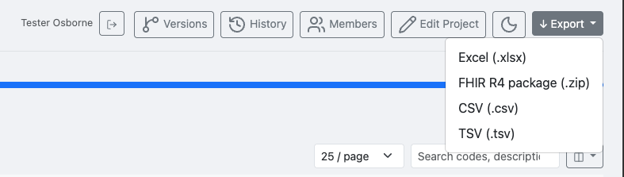
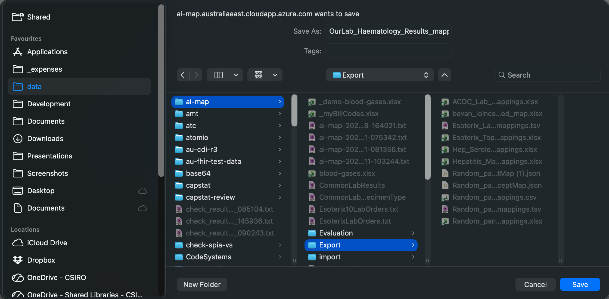
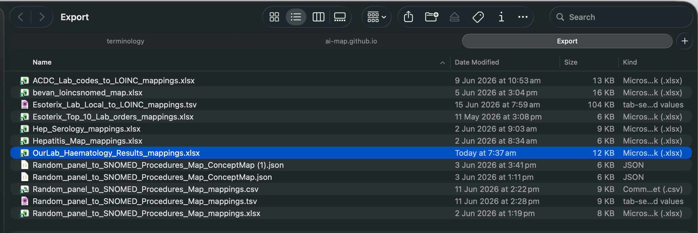
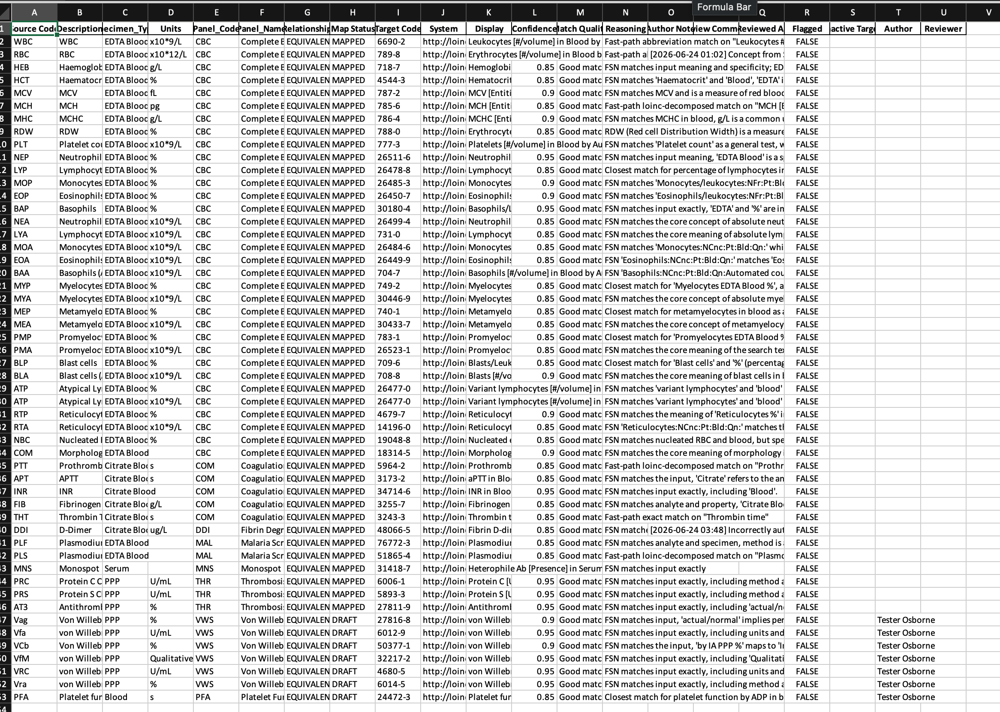
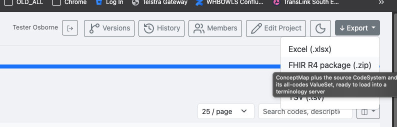
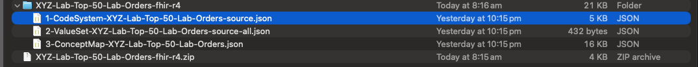

# Exporting

Once a version is finalised, click the **Export** button in the project toolbar and select a format.



| Format | Use case |
| ------ | -------- |
| **Excel (.xlsx)** | Human-readable review, loading into LIS/EMR import tools. |
| **FHIR R4 package (.zip)** | Loading into a FHIR server or terminology service such as Ontoserver. See [The FHIR R4 package](#the-fhir-r4-package). |
| **CSV (.csv)** | Integration with data pipelines and scripts. |
| **TSV (.tsv)** | Tab-separated variant of CSV for tools that prefer it. |

A system save dialog opens. Choose a destination folder and confirm the filename.



*The default filename includes the project name. Choose your export folder and click **Save**.*

The exported file appears in the chosen location.



*The `.xlsx` export alongside other mapping files. The filename reflects the project name and export date.*

## Export file contents

The Excel export contains one row per source code with all mapping metadata.



*Key columns in the export: Source Code, Description, additional source columns (Specimen Type, Units, etc.), Map Status, Target Code, System, Display, Confidence score, Match Quality, AI Reasoning, Author, Reviewed By, Flagged, and Active Target.*

This file is the primary handoff artefact for loading mappings into a LIS or EMR.

## The FHIR R4 package

The **FHIR R4 package** export is a zip of three FHIR R4 resources, not a single ConceptMap. Hover over the menu item for a reminder of what it contains.



*The **FHIR R4 package (.zip)** option and its tooltip: the ConceptMap plus the source CodeSystem and its all-codes ValueSet, ready to load into a terminology server.*

!!! warning "Set the Source Code System URL first"
    The package cannot be built without a **Source Code System URL**, because it is the
    canonical URL of the exported CodeSystem. If the project has none, the export is refused
    with *"This project has no source system URL, so a FHIR package cannot be built…"*.
    Set it under **FHIR ConceptMap URLs** in **Edit Project** (see
    [Getting Started](getting-started.md#creating-a-project)) and export again.

Unzipped, the package holds three files, numbered in the order they must be loaded:



*The downloaded `XYZ-Lab-Top-50-Lab-Orders-fhir-r4.zip` and its three files. The ids in the filenames are derived from the project name.*

| File | Contains |
| ---- | -------- |
| `1-CodeSystem-<id>.json` | Every source code in the active version, mapped or not, with its description. |
| `2-ValueSet-<id>.json` | A value set of all codes in that CodeSystem. |
| `3-ConceptMap-<id>.json` | The mappings, as a valid FHIR R4 ConceptMap. |

A few things about the ConceptMap are worth knowing before you publish it:

- **Its id and canonical URL come from the project name**, so maps from different projects (or different AI-Map instances) do not overwrite each other on a shared server. Renaming the project changes the id.
- **A published source value set is referenced, not redefined.** If the project's **Source ValueSet URL** points at an existing value set, the ConceptMap's `sourceUri` refers to it and the package's ValueSet is emitted at a separate all-codes URL, so your curated set is never replaced.
- **A source code listed more than once is merged** into a single element carrying each of its targets, so no mapping is lost.
- **Mapper notes are not published.** Inexact and Narrower mappings, which FHIR requires to carry a comment, get a standard comment describing the relationship instead.

## Loading the package into a terminology server

AI-Map does not push anything to a FHIR server itself; the package is a file download only. Load the three files **in order**: the ValueSet refers to the CodeSystem, and the ConceptMap refers to both. Ontoserver refuses a ConceptMap whose source it cannot resolve, so loading the ConceptMap on its own fails.

Each file carries its own `id`, so `PUT` it to `<base>/<ResourceType>/<id>`. For example, with `curl`:

```bash
FHIR=https://your-terminology-server/fhir
unzip XYZ-Lab-Top-50-Lab-Orders-fhir-r4.zip -d package && cd package

for f in 1-CodeSystem-*.json 2-ValueSet-*.json 3-ConceptMap-*.json; do
  type=$(echo "$f" | cut -d- -f2)                 # CodeSystem, ValueSet, ConceptMap
  id=$(python3 -c "import json,sys; print(json.load(open(sys.argv[1]))['id'])" "$f")
  curl -sS -X PUT "$FHIR/$type/$id" \
       -H "Content-Type: application/fhir+json" \
       --data-binary @"$f" -w " -> $type/$id %{http_code}\n" -o /dev/null
done
```

Add an `Authorization` header if your server requires one. Postman or your server's own import tooling work equally well, as long as the order is kept.

For the ConceptMap to carry a complete `targetUri`, also set the **Target ValueSet URL** under **FHIR ConceptMap URLs** (it is pre-filled from the context binding when one is available).
